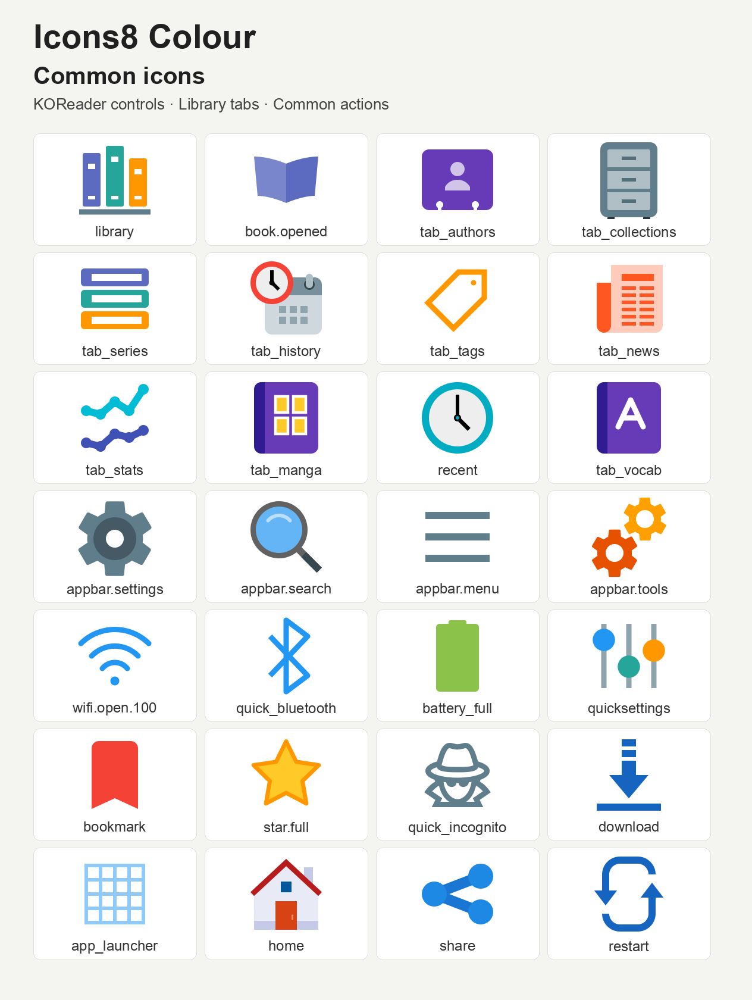
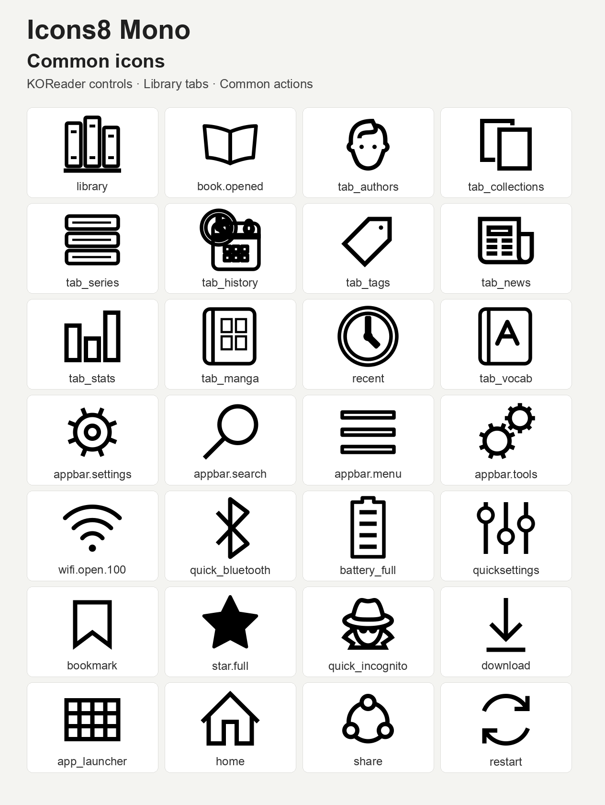

# Icons8 Icon Packs for ZenOS

[Icons8 Flat Color](https://github.com/icons8/flat-color-icons) and
[Icons8 Windows 10 outlines](https://github.com/icons8/windows-10-icons), adapted
and packaged by [ZenLabs](https://github.com/xZenLabs) for
[ZenOS](https://github.com/xZenLabs/zen-os) and KOReader.

## Icon overviews

### Icons8 Colour



### Icons8 Mono



| Pack | Style | Release asset |
|---|---|---|
| **Icons8 Colour** | Original multicolour Flat Color artwork, with supplementary UI symbols | `zen-icons8-colour.zip` |
| **Icons8 Mono** | Native Windows 10 outlines, with matching outline adaptations | `zen-icons8-mono.zip` |

Each style has **244 editable SVGs** using its exact runtime lookup filenames.
Both packs theme all **23 built-in choices under Navbar → Tabs → Add → Tab**.
KOReader and Zen icons retain their exact lookup names. Shared artwork under
different lookup names is stored as editable source SVGs. No Lua manifests are needed.

## Included icons

ZenPM's KOReader frontend is covered: all **39 bundled SVG names** and
**33 inline menu names** (**63 unique lookups**). Navigation, all 12 categories,
package and queue actions, verification badges, source icons, search, filtering,
sorting and settings use matching artwork. ZenPM must support the selected ZenOS
icon pack for these replacements to appear. Downloaded package logos and previews
retain their own artwork.

Library uses upright books on a shelf; Series uses a horizontal stack of books.
News, tags, folders, manga, authors, collections, reading history, vocabulary,
and statistics have themed icons. Controls and Quick Settings use three sliders.
The vertical three-dot menu and a plain close X are included.

Both styles include battery levels and charging, signal-level Wi-Fi variants,
Bluetooth, incognito, the launcher, restart, sleep, power, calculator, database,
CPU, USB, sharing, text alignment, page columns, and orientation controls.
Books and several simple UI symbols are adaptations or supplementary designs.
The Mono pack uses native outline icons where available; remaining counterparts
use outlined geometry. The Colour pack retains original Flat Color SVGs where
appropriate and supplements missing UI symbols with coloured Icons8 outlines.

The free source sets do not cover every application control. Cloud, Zen mode, streak,
chess, Connections, Notion, RSS, and unmatched KOReader status glyphs use the
bundled ZenOS or KOReader artwork. Battery SVGs theme icon lookups; inline battery
font glyphs continue to use their fonts.

See [icon-sources.csv](icon-sources.csv) for every source filename, pinned upstream
link, and adaptation.

## Install

1. Download `zen-icons8-colour.zip` or `zen-icons8-mono.zip` from
   [the latest release](https://github.com/xZenLabs/icons8-icon-pack/releases/latest).
2. Copy the ZIP into `koreader/icons/zen/` on your device. Create the folders if needed.
3. Open **Zen Settings → Interface**, enable **Custom icons**, then select
   **Icons8 Colour for ZenOS** or **Icons8 Mono for ZenOS** under
   **Custom icons → Custom icon pack**. ZenOS validates and extracts the ZIP.
4. Restart KOReader.

You can also extract the ZIP and copy its `zen-icons8-colour` or `zen-icons8-mono`
folder into `koreader/icons/zen/`. Keep `pack.json` and the SVG files directly in
that folder. Select another pack, or disable Custom icons, to restore default artwork.
See the [ZenOS icon pack guide](https://github.com/xZenLabs/zen-os/blob/main/docs/icon-packs.md).

## Source layout

Each style keeps category folders directly beside `pack.json`.
Categories without replacement artwork can be absent:

```text
<Style>/
├── pack.json
├── navbar/
├── controls/                 # Quick settings and Zen controls
├── launcher/
├── zenpm/                    # Includes verification shields
├── lookup/
├── menus/                    # Zen menu entry points
├── reader/                   # Page browser: TOC, vocabulary, view modes
├── device/
└── koreader/                 # Stock KOReader icons, including plus/info
```

[ICON-LIST.md](ICON-LIST.md) lists the filenames by category. Page-browser TOC, vocabulary-builder,
and view icons belong in `reader/`. All stock KOReader icons, including `appbar.*`,
the Aa font button, plus/info, bookmarks, and `book_open`, belong in `koreader/`. Quick settings
belong in `controls/`; `tab_left` and `tab_right` belong in `navbar/`.
Shared lookup names appear only once per style;
different lookup names can be edited independently.

Legacy SimpleUI `qa_group` and `qa_plugin` files are omitted. ZenPM uses
`plugin.svg`; its verification shields belong in `zenpm/`.
The builder flattens the categories into the pack root in release ZIPs,
so installed lookup names and artwork remain unchanged apart from the two
obsolete SimpleUI names. Missing icons keep their normal bundled fallbacks.

## Build

Each pack manifest includes `"color": true` for colour artwork or
`"color": false` for monochrome artwork. Per-style values are retained in the
release ZIPs when building the whole repository.

```sh
python3 -m venv .venv
source .venv/bin/activate
python3 -m pip install -r scripts/requirements.txt
python3 -m unittest discover -s scripts -p 'test_*.py'
python3 scripts/build-zen-packs.py
```

The resulting ZIPs are in `dist/`. The Python builder, archive validation,
SimpleUI filename conversion, and optional legacy `pack.lua` parser come from
[Zen icon pack template](https://github.com/xZenLabs/icon-pack-template).
This pack has no Lua scripts. Existing source filenames take precedence over
editable lookup aliases. Missing icons remain available through ZenOS's normal fallback.

Build one style with `python3 scripts/build-zen-packs.py "Icons8 Colour"`, or
pass `"Icons8 Mono"`. Use `--output` to choose an output folder and `--version`
to override metadata. Root `pack.json` supplies shared metadata for the two-pack
build; per-style manifests supply metadata when building a style directly.

The release workflow runs on pushes to `main` and through **Actions → Release
Zen icon packs → Run workflow**. When a push increases root `pack.json`'s
version above its value on `main` before the push, it releases that exact version.
Otherwise, including manual workflow runs, it selects the next patch version above
the higher of root `pack.json` and existing release tags. It runs tests, validates
both packs, and publishes their ZIPs.

## Credits and licence

- Icons8's Flat Color and Windows 10 source repositories offer the icons under **MIT**.
- Adaptations and supplementary artwork by **xZenLabs** also use MIT.
- Repository code uses **AGPL-3.0**, retained from this repository's original licence.
- See [LICENSE-ICONS.txt](LICENSE-ICONS.txt), the original upstream notices in
  [licenses](licenses/), and the code [LICENSE](LICENSE).

Feedback and icon requests: [GitHub issues](https://github.com/xZenLabs/icons8-icon-pack/issues).
Support ZenLabs through [Ko-fi](https://ko-fi.com/xzenlabs).
